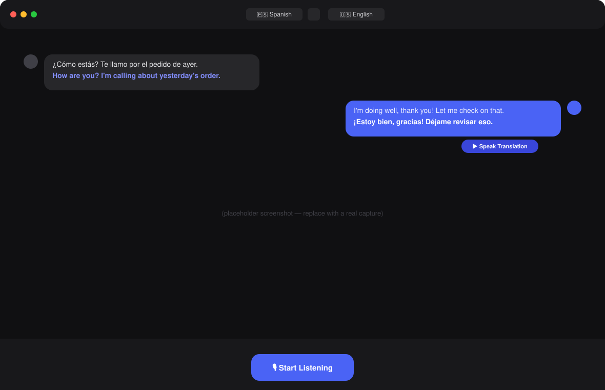

<div align="center">
  
  <h1>LiveTranslate</h1>
  <p><b>Real-time, fully offline speech translation for phone calls, on macOS.</b></p>
  <p>
    <a href="https://github.com/livetranslate/livetranslate/actions/workflows/ci.yml"></a>
    <a href="LICENSE"></a>
    
    
  </p>
</div>

---

**LiveTranslate** turns your Mac into a real-time interpreter for phone
calls. Put your laptop next to your phone on speaker: the other person's
speech is transcribed and translated on screen as they talk, and when you
reply, one tap speaks your translated response out loud through your
speakers — all running **entirely on-device**, with no cloud APIs, no
OpenAI, no Google Translate, no internet required after setup.



## Features

- 🎙️ **Continuous conversation mode** — incoming speech is transcribed and
  translated automatically with voice-activity detection; no button mashing.
- 🔊 **One-tap reply** — speak your response, preview the translation, hit
  **Speak Translation** and it plays through your speakers in the target
  language.
- 🌐 **29+ languages**, auto-detect for the incoming side, independent
  language selection for each direction.
- 🧠 **100% local AI** — [whisper.cpp](https://github.com/ggerganov/whisper.cpp)
  (speech recognition, Metal-accelerated), [NLLB-200](https://ai.meta.com/research/no-language-left-behind/)
  via [CTranslate2](https://github.com/OpenNMT/CTranslate2) (translation),
  and [Piper](https://github.com/rhasspy/piper) (speech synthesis).
- 🪟 **Floating subtitles** — a transparent always-on-top overlay for
  glanceable translations while your call is on speaker.
- 📝 **Full conversation history** — search, timestamps, speaker labels,
  export to TXT / JSON / SRT.
- 🎨 A native-feeling, polished UI: dark/light mode, adjustable font size,
  keyboard shortcuts, native macOS menus and notifications.
- 🔒 **Private by design** — no network access at runtime; your
  conversations never leave your machine.

## Offline guarantee

After running `npm run setup:models` once (which needs internet to download
model weights and native binaries), **LiveTranslate makes zero network
requests at runtime.** You can verify this yourself — turn off Wi-Fi and
Ethernet and the app works identically. The renderer's Content-Security-Policy
does not permit any `connect-src` beyond `'self'`.

## Installation

### Download (recommended)

Grab the latest signed `.dmg` from the [Releases page](https://github.com/livetranslate/livetranslate/releases),
drag LiveTranslate to Applications, and launch it. On first launch it will
prompt for microphone access.

### Build from source

Requires macOS 13+ (Apple Silicon recommended; Intel supported via CPU
inference), Node.js 20+, Xcode Command Line Tools, and CMake. **You do not
need Python installed** — `setup:models` provisions its own fully
self-contained, portable Python runtime under `resources/python/`, used only
by LiveTranslate.

```bash
git clone https://github.com/livetranslate/livetranslate.git
cd livetranslate
npm install

# One-time: builds whisper.cpp + a portable Python runtime, downloads model
# weights, and installs CTranslate2 + NLLB-200 + piper-tts into that runtime.
# Requires internet access; ~2GB download. Never needed again after this.
npm run setup:models

npm run electron:dev
```

## Development

```bash
npm run electron:dev     # Run the app with hot reload
npm run typecheck        # Strict TypeScript across main + renderer
npm run lint              # ESLint
npm run format             # Prettier
npm test                    # Vitest unit tests
npm run dist:mac            # One command: provisions everything (if not already
                             # done) and packages a fully self-contained .dmg
                             # that runs on any Mac of the same CPU architecture
                             # — no Python, Homebrew, or setup required there.
```

See [docs/ARCHITECTURE.md](docs/ARCHITECTURE.md) for how the pipeline is
structured (main vs. renderer, the VAD → STT → Translate → TTS flow, and the
typed IPC contract), and [docs/CODE_SIGNING.md](docs/CODE_SIGNING.md) for
notarizing release builds.

### Project layout

```
src/
├── main/        Electron main process — window mgmt, IPC, settings, menus
├── preload/      Typed contextBridge API surface
├── renderer/      React UI (Vite + Tailwind)
├── ai/             Local AI engine wrappers (VAD, whisper.cpp, NLLB, Piper)
└── shared/          Types, IPC contract, and language definitions
```

## Model information

| Stage                    | Model                                       | Size         | Acceleration              |
| ------------------------ | ------------------------------------------- | ------------ | ------------------------- |
| Voice activity detection | Built-in energy/ZCR detector                | 0 MB         | CPU (negligible cost)     |
| Speech recognition       | whisper.cpp — tiny / base / small / medium  | 75–539 MB    | Metal (Apple Silicon GPU) |
| Translation              | NLLB-200 distilled 600M, int8 (CTranslate2) | ~620 MB      | CPU                       |
| Speech synthesis         | Piper neural TTS, per-language voices       | ~63 MB/voice | CPU                       |

Swap in a larger Whisper model any time via **Settings → Recognition →
Speech model** for higher accuracy at the cost of latency, or re-run
`scripts/setup-models.sh --stt-model medium`.

## Performance

On an M2 MacBook Air, with the default `whisper-base` model and `balanced`
latency mode:

- Voice activity detection: <1ms per 30ms frame
- Speech recognition: ~300–700ms for a typical 3–5 second utterance
- Translation: ~80–150ms per utterance
- Speech synthesis: real-time or faster (a 2-second reply synthesizes in well under 2s)

End-to-end, a typical conversational turn appears within roughly 0.5–1
second of the speaker finishing — fast enough for natural back-and-forth.

## Known limitations

- The laptop microphone is the only audio input — LiveTranslate doesn't tap
  into the phone call's audio directly, so it relies on you positioning your
  Mac where it can hear the call clearly (e.g., phone on speaker next to the
  laptop).
- Translation quality depends on utterance length and background noise;
  very short utterances (single words) translate less reliably.
- Piper TTS voices aren't available for every supported language yet (see
  `src/shared/languages.ts` for current coverage) — unsupported target
  languages show translated text but can't speak it aloud.
- Whisper's language auto-detection needs a few seconds of speech to be
  reliable; very short first utterances may be misdetected.
- Intel Macs work but are noticeably slower (Metal acceleration is
  Apple-Silicon-only); consider `whisper-tiny` and `latencyMode: fastest`.

## Roadmap

- [ ] Silero VAD (ONNX) as a drop-in, higher-accuracy alternative to the
      built-in energy detector
- [ ] Speaker diarization for multi-party calls
- [ ] Windows/Linux support (the pipeline is OS-agnostic; packaging isn't yet)
- [ ] In-app model manager (download/swap models without the CLI script)
- [ ] Additional Piper voices bundled by default
- [ ] iOS companion app for true call-audio capture

## FAQ

**Does this send my conversations anywhere?**
No. Every AI model runs locally as a child process or in-process; the app's
CSP blocks any outbound network connection.

**Why not just use Google Translate's app?**
Google Translate's conversation mode requires an internet connection and
sends your audio to Google's servers. LiveTranslate is built for people who
want that workflow with zero data leaving their machine.

**Can I use this on a call where I can't put the phone on speaker?**
Not currently — LiveTranslate listens via the laptop microphone. A future
release may add phone audio capture via Bluetooth/AirPlay routing.

**Why is the first launch slow?**
`scripts/setup-models.sh` needs to download whisper.cpp's weights, a portable
Python runtime, an NLLB-200 translation model, and Piper voices (~2GB total)
— a one-time cost.

## Troubleshooting

| Symptom                                   | Fix                                                                                                                 |
| ----------------------------------------- | ------------------------------------------------------------------------------------------------------------------- |
| "Microphone access denied"                | System Settings → Privacy & Security → Microphone → enable LiveTranslate                                            |
| Translation stage shows an error          | Re-run `npm run setup:models` — the portable Python runtime or NLLB weights may be missing/corrupt                  |
| No sound on "Speak Translation"           | Check the target language has a Piper voice in `src/shared/languages.ts`; download it via `scripts/setup-models.sh` |
| High CPU usage                            | Switch to `whisper-tiny` and `latencyMode: fastest` in Settings                                                     |
| App won't open ("unidentified developer") | Right-click → Open, or see [docs/CODE_SIGNING.md](docs/CODE_SIGNING.md) if you built it yourself                    |

## Contributing

Contributions are welcome! Please read [CONTRIBUTING.md](CONTRIBUTING.md) and
our [Code of Conduct](CODE_OF_CONDUCT.md) before opening a PR.

## License

[MIT](LICENSE) © LiveTranslate Contributors
