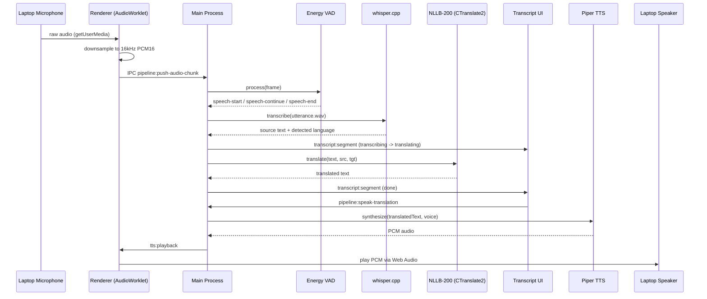

# Architecture

LiveTranslate is an Electron app with a strict separation between the main
process (Node, owns AI engines and OS integration) and the renderer (React,
owns UI and microphone capture via Web Audio).

```
src/
├── main/                 Electron main process
│   ├── index.ts           App bootstrap, window creation, IPC wiring
│   ├── pipeline-manager.ts   Orchestrates VAD -> STT -> Translate -> TTS
│   ├── settings-store.ts  Persisted user settings (electron-store)
│   ├── menu.ts             Native macOS menu bar
│   └── transcript-export.ts  TXT / JSON / SRT export
├── preload/               contextBridge-exposed, typed IPC surface
├── renderer/               React app (Vite)
│   ├── components/         UI components
│   ├── hooks/               usePipelineSync, useConversation, useTheme
│   ├── services/            audioCapture (mic -> 16kHz PCM), ttsPlayback
│   └── store/                zustand app store
├── ai/                     AI engine wrappers (used only from main)
│   ├── vad/                 Energy + zero-crossing voice activity detector
│   ├── whisper/              whisper.cpp CLI wrapper (speech recognition)
│   ├── translate/            CTranslate2 + NLLB-200 sidecar (Python)
│   └── tts/                  Piper CLI wrapper (speech synthesis)
└── shared/                  Types and constants shared by main + renderer
```

## Data flow



## Why these models

| Stage       | Engine                                                                                                                                       | Why                                                                                                                                                           |
| ----------- | -------------------------------------------------------------------------------------------------------------------------------------------- | ------------------------------------------------------------------------------------------------------------------------------------------------------------- |
| VAD         | Custom energy + zero-crossing-rate detector                                                                                                  | Zero model weights, sub-millisecond per frame, tuned for laptop-mic phone-call audio; swappable for Silero VAD (ONNX) without touching the pipeline contract. |
| STT         | [whisper.cpp](https://github.com/ggerganov/whisper.cpp)                                                                                      | Best-in-class open speech recognition; Metal backend gives real-time-or-faster decoding on Apple Silicon; ships as a single static binary, easy to bundle.    |
| Translation | [NLLB-200 distilled 600M](https://huggingface.co/facebook/nllb-200-distilled-600M) via [CTranslate2](https://github.com/OpenNMT/CTranslate2) | Covers 200 languages out of the box, matches the app's language list; CTranslate2's int8 quantization keeps translation latency under ~150ms on CPU.          |
| TTS         | [Piper](https://github.com/rhasspy/piper)                                                                                                    | Fastest fully-local neural TTS available; per-language ONNX voices, real-time-or-faster synthesis on CPU.                                                     |

## IPC contract

All main <-> renderer communication is typed in `src/shared/ipc.ts`
(`IpcInvokeMap` for request/response, `IpcEventMap` for main -> renderer
events) and consumed through the `window.liveTranslate` API exposed by
`src/preload/index.ts`. No renderer code touches Node or Electron APIs
directly — the preload script is the only privilege boundary crossing.

## Process model

- **Main process**: owns the whisper.cpp / Piper child processes and the
  long-lived Python translation sidecar (`translate_server.py`), plus all OS
  integration (menus, global shortcuts, file dialogs, tray).
- **Renderer**: owns `getUserMedia` capture and playback, and is otherwise a
  thin, sandboxed presentation layer (`nodeIntegration: false`,
  `contextIsolation: true`, `sandbox: true`).
- **Translation sidecar**: a single persistent `python3 translate_server.py`
  process communicating over stdio via newline-delimited JSON, so the
  (multi-second) model load happens once per app launch, not per utterance.
